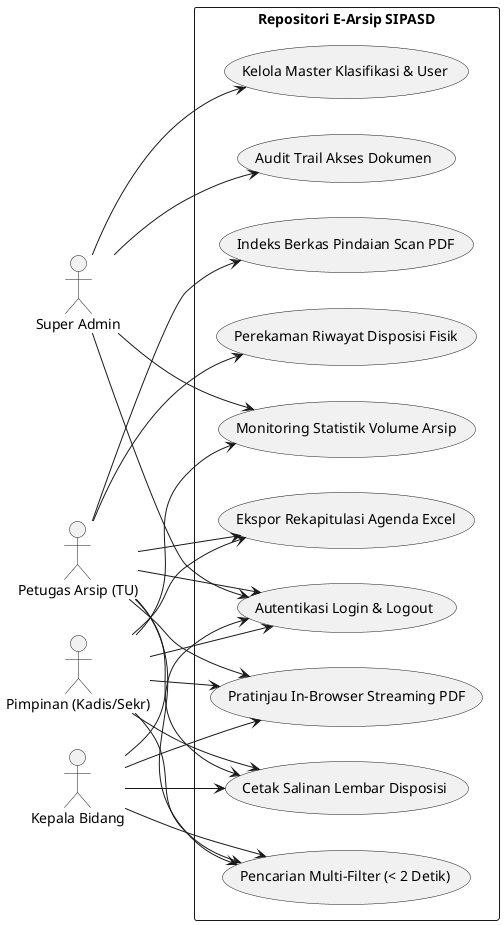
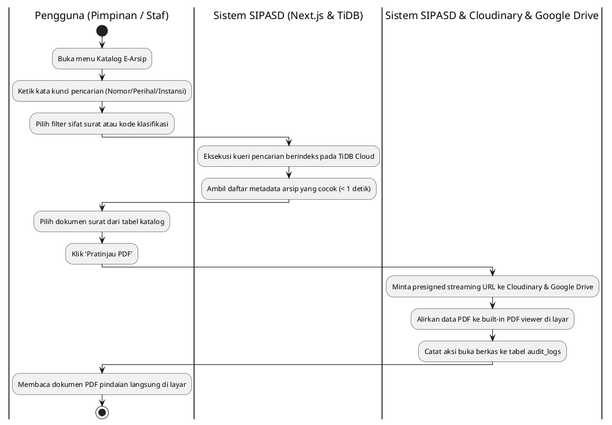
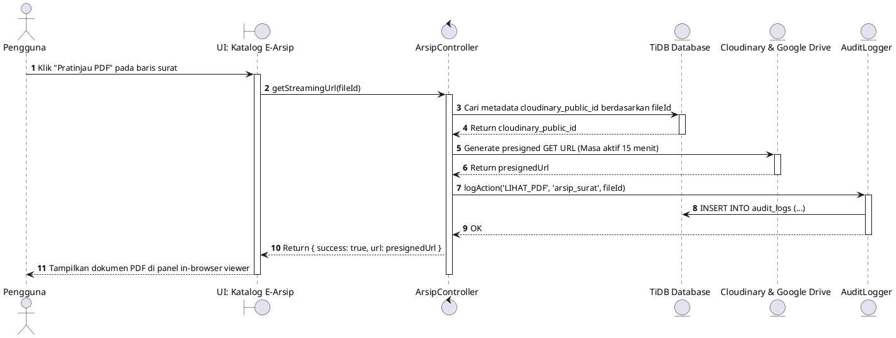

# SPESIFIKASI DIAGRAM UML SISTEM SIPASD
**Materi Lengkap Bab III Analisis dan Perancangan - Laporan Magang TI UNISKA**  
*Mencakup skenario Use Case, Activity Diagram, Sequence Diagram, dan Class Diagram E-Arsip Digital (Dilengkapi Kode PlantUML)*

---

## 1. Use Case Diagram E-Arsip

### A. Matriks Aktor dan Use Case

| Aktor | Deskripsi Peran | Use Case yang Dapat Diakses |
| :--- | :--- | :--- |
| **Super Admin** | Administrator Teknis IT Dispora | Kelola Akun Pengguna, Kelola Master Klasifikasi, Lihat Audit Trail, Akses Seluruh Arsip. |
| **Petugas Arsip (TU)** | Staf Subbag Umum & Kepegawaian (Tata Usaha) | Pengindeksan Berkas Pindaian PDF, Catat Riwayat Disposisi Fisik, Ekspor Agenda Excel. |
| **Pimpinan** | Kepala Dinas / Sekretaris Dinas | Temu-Kembali Arsip (< 2 Detik), Pratinjau Streaming PDF, Pantau Statistik Volume Arsip. |
| **Kepala Bidang** | Pimpinan Unit Kerja Pelaksana | Cari & Lihat Arsip Surat Masuk/Keluar Bidang, Unduh Dokumen PDF, Cetak Salinan Disposisi. |

### B. Deskripsi Tekstual Use Case Utama

#### Use Case: Temu-Kembali Dokumen & Pratinjau Streaming PDF (< 2 Detik)
- **Aktor**: Pimpinan / Kepala Bidang / Petugas Arsip.
- **Prasyarat**: Pengguna telah terautentikasi ke sistem web SIPASD.
- **Skenario Normal**:
  1. Pengguna membuka menu Katalog Arsip Surat Masuk atau Surat Keluar.
  2. Pengguna mengetikkan kata kunci pencarian (misal: `Kejuaraan Daerah` atau `0973`) pada kolom pencarian instan.
  3. Sistem melakukan kueri pencarian berindeks pada database TiDB Cloud dan menampilkan daftar arsip yang cocok dalam waktu kurang dari 1 detik.
  4. Pengguna menekan baris arsip atau tombol **"Pratinjau PDF"**.
  5. Sistem meminta presigned stream URL terenkripsi dari Cloudinary & Google Drive dan memuat berkas PDF langsung pada panel pemutar dokumen (*built-in streaming PDF viewer*) di samping tabel.
  6. Pengguna membaca dokumen PDF secara lengkap tanpa perlu mengunduh file fisik ke memori laptop/ponsel.
- **Kondisi Akhir**: Dokumen terbuka lancar di browser dan riwayat pencarian terekam di tabel `audit_logs`.

#### Use Case: Pengindeksan Berkas Pindaian PDF & Catat Disposisi Fisik
- **Aktor**: Petugas Arsip (TU).
- **Prasyarat**: Petugas memiliki berkas fisik surat yang telah dipindai menjadi PDF dari Google Drive.
- **Skenario Normal**:
  1. Petugas membuka menu **Pengindeksan Arsip Baru**.
  2. Petugas mengunggah berkas PDF pindaian (otomatis terkirim ke Cloudinary & Google Drive).
  3. Petugas menginputkan Nomor Surat, Tanggal Surat, Tanggal Diterima, Asal Instansi, Kode Klasifikasi, Perihal, dan Ringkasan Isi.
  4. Petugas mencatat dokumentasi coretan pimpinan yang tertera pada lembar kertas fisik: nama pejabat pendisposisi, tanggal disposisi, bidang tujuan, instruksi yang dicentang, dan arahan tertulis.
  5. Petugas menekan tombol **Simpan Indeks Arsip**.
  6. Sistem menerbitkan Nomor Agenda Tahunan otomatis dan menyimpan seluruh metadata ke basis data TiDB.
- **Kondisi Akhir**: Arsip terindeks sempurna dan siap ditemukan oleh seluruh pegawai berhak akses.

### C. Kode PlantUML: Use Case Diagram

---

## 2. Activity Diagram: Temu-Kembali Dokumen & Pratinjau PDF

---

## 3. Sequence Diagram: Streaming Viewer Berkas PDF

