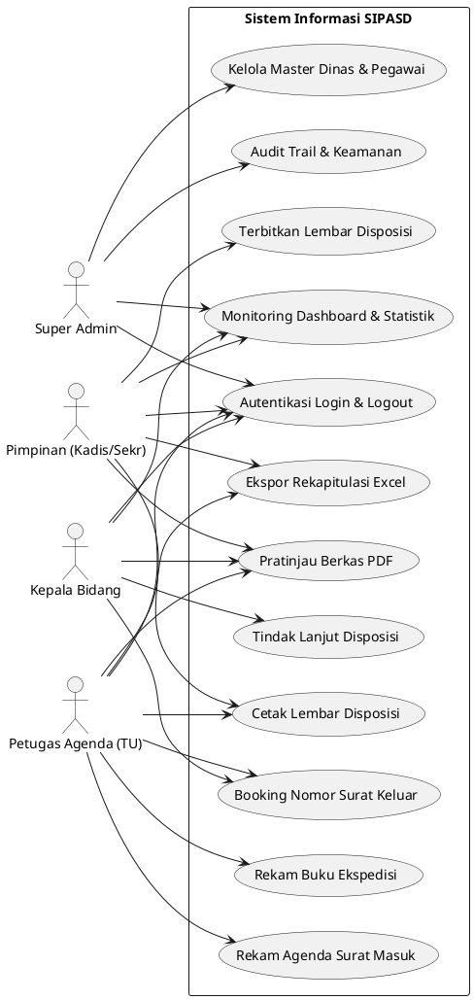
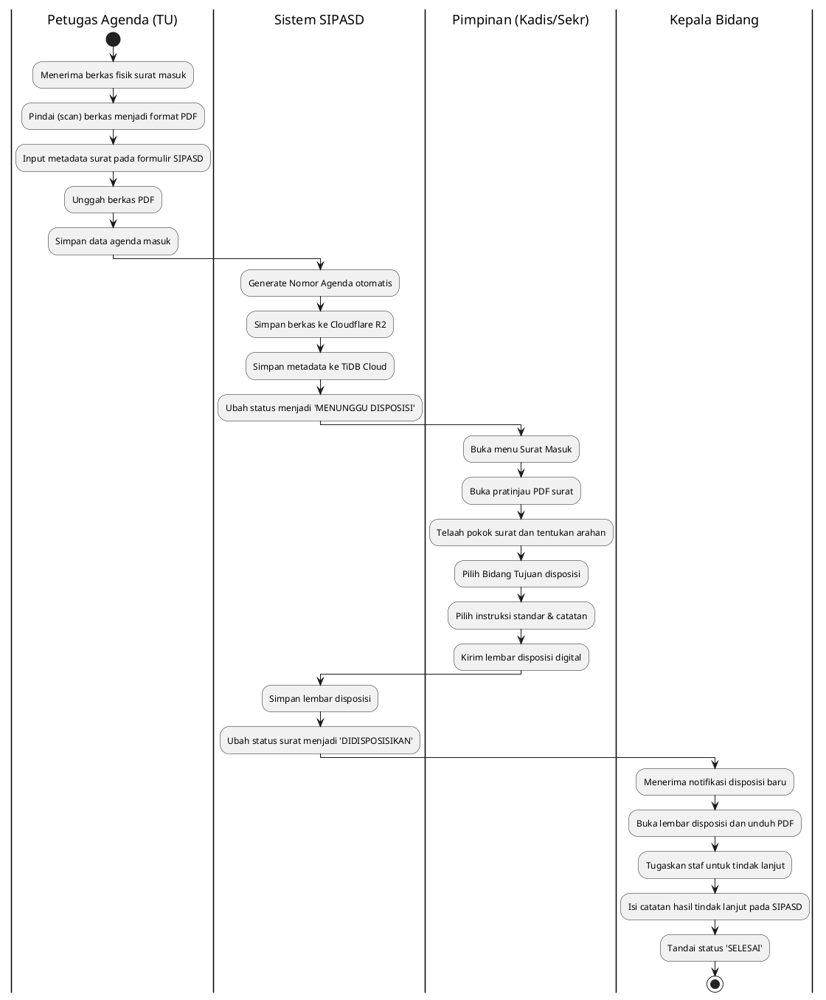
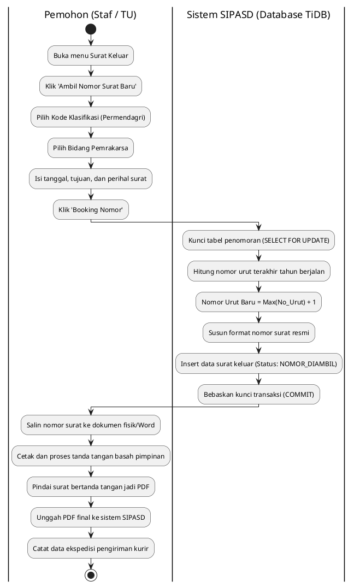
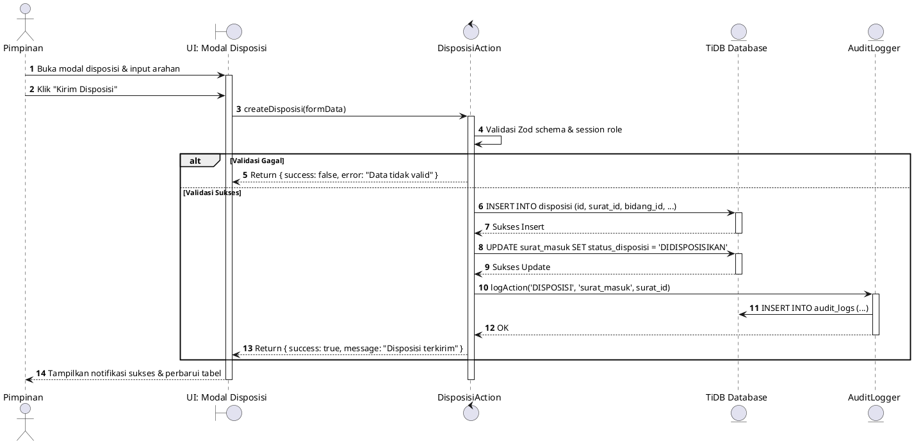
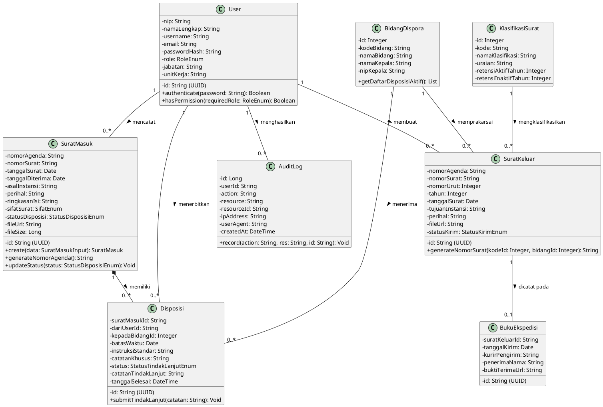

# SPESIFIKASI DIAGRAM UML SISTEM SIPASD
**Materi Lengkap Bab III Analisis dan Perancangan — Laporan Magang TI UNISKA**  
*Mencakup skenario Use Case, Activity Diagram, Sequence Diagram, dan Class Diagram (Dilengkapi Kode PlantUML)*

---

## 1. Use Case Diagram

### A. Matriks Aktor dan Use Case

| Aktor | Deskripsi Peran | Use Case yang Dapat Diakses |
| :--- | :--- | :--- |
| **Super Admin** | Administrator Teknis IT Dispora | Kelola Data Pengguna, Kelola Master Dinas, Lihat Audit Trail, Akses Seluruh Modul. |
| **Pimpinan** | Kepala Dinas / Sekretaris Dinas | Telaah Surat Masuk, Pratinjau PDF, Terbitkan Disposisi, Monitoring Dashboard, Ekspor Laporan. |
| **Petugas Agenda** | Staf Subbag Umum & Kepegawaian (TU) | Rekam Surat Masuk, Unggah PDF, Booking Nomor Surat Keluar, Cetak Buku Ekspedisi & Agenda. |
| **Kepala Bidang** | Pimpinan Unit Kerja Pelaksana | Lihat Disposisi Masuk, Unduh PDF Lampiran, Perbarui Status Tindak Lanjut, Ambil Nomor Surat Keluar Bidang. |

### B. Deskripsi Tekstual Use Case Utama

#### Use Case: Menerbitkan Disposisi Surat Masuk
- **Aktor**: Pimpinan (Kepala Dinas / Sekretaris).
- **Prasyarat**: Pengguna telah terautentikasi dengan hak akses `PIMPINAN` dan terdapat surat masuk berstatus `MENUNGGU`.
- **Skenario Normal**:
  1. Pimpinan membuka modul Surat Masuk dan memilih surat yang akan ditelaah.
  2. Sistem menampilkan ringkasan metadata surat dan pratinjau PDF berkas fisik.
  3. Pimpinan menekan tombol **"Beri Disposisi"**.
  4. Sistem memunculkan jendela modal lembar disposisi.
  5. Pimpinan memilih Bidang Tujuan (misal: *Bidang Pembudayaan Olahraga*), menentukan tanggal batas waktu tindak lanjut, mencentang instruksi standar (*Tindak lanjuti / Koordinasikan / Hadiri*), dan mengetikkan catatan khusus.
  6. Pimpinan menekan tombol **"Kirim Disposisi"**.
  7. Sistem memvalidasi input, menyimpan data ke tabel `disposisi`, memperbarui status surat masuk menjadi `DIDISPOSISIKAN`, mencatat jejak di `audit_logs`, dan mengirim notifikasi visual ke akun Kepala Bidang.
- **Kondisi Akhir**: Disposisi tersimpan dan langsung muncul pada dashboard Kepala Bidang tujuan.

#### Use Case: Booking Nomor Surat Keluar (Anti-Nomor Dobel)
- **Aktor**: Petugas Agenda (TU) / Staf Bidang.
- **Prasyarat**: Pengguna terautentikasi dan memiliki draf surat dinas yang siap diberi nomor.
- **Skenario Normal**:
  1. Pengguna membuka modul Surat Keluar dan menekan tombol **"Ambil Nomor Surat Baru"**.
  2. Pengguna memilih Kode Klasifikasi (misal: `426` Keolahragaan), Bidang Pemrakarsa, tanggal surat, instansi tujuan, dan perihal surat.
  3. Pengguna menekan tombol **"Generate Nomor"**.
  4. Sistem memulai transaksi atomik database (`BEGIN TRANSACTION ... FOR UPDATE`).
  5. Sistem menghitung nomor urut tertinggi pada tahun berjalan untuk bidang tersebut (`MAX(nomor_urut) + 1`), menyusun format resmi: `426/0412-Sekr/DISPORA/2026`, dan menyimpan status sebagai `NOMOR_DIAMBIL`.
  6. Sistem melakukan `COMMIT` transaksi dan menampilkan nomor resmi di layar.
- **Kondisi Akhir**: Nomor surat resmi terkunci dan tidak dapat diambil oleh pengguna lain.

### C. Kode PlantUML: Use Case Diagram

---

## 2. Activity Diagram

### A. Alur Penerimaan Surat Masuk dan Disposisi Pimpinan

### B. Alur Permintaan Nomor Surat Keluar (Anti-Nomor Dobel)

---

## 3. Sequence Diagram

### Sequence Diagram: Penerbitan Disposisi oleh Pimpinan

---

## 4. Class Diagram

